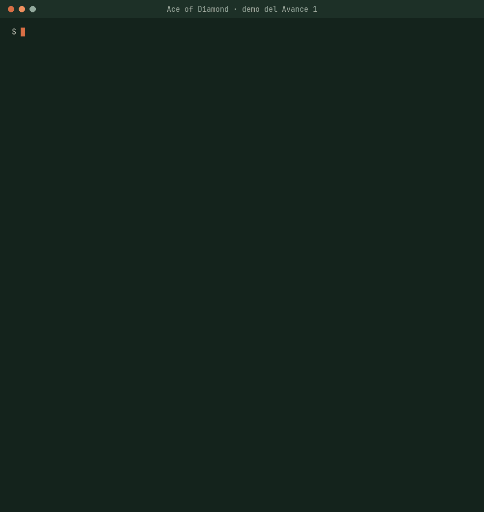

# Ace of Diamond

**Autor:** Emmanuel Gutierrez Cruz

**Materia:** Modelado y Simulación

**Universidad:** ENES Morelia

**Contacto:** emmanuelgc241@gmail.com


## Objetivo
Simulador estocástico en C para analizar récords de Home Runs en la MLB. Utiliza el método de Monte Carlo para simular hasta un millón de temporadas posibles de un jugador y responder dos preguntas:

1. **Análisis:** ¿qué tan inusual fue una temporada histórica (p. ej. Bonds 2001, Judge 2022)? ¿Era predecible o fue una anomalía estadística?
2. **Predicción:** ¿cuántos jonrones podría pegar un jugador en una temporada que todavía no empieza?

## Modelo matemático
Cada turno al bate se modela como un experimento aleatorio con una pequeña probabilidad de jonrón, y una temporada es la suma de todos sus turnos:

```math
HR = \sum_{j=1}^{PA} Y_j, \qquad Y_j \sim \text{Bernoulli}(p_j)
```

La probabilidad de jonrón en cada turno, $`p_j`$, combina el talento del jugador con el contexto de ese turno:

```math
\text{logit}(p_j) = \text{logit}(\theta) + c_j
```

donde el talento del jugador combina una distribución Beta con un ajuste por edad:

```math
\text{logit}(\theta) = \text{logit}(\tilde\theta) + \Delta_{\text{edad}}, \qquad \tilde\theta \sim \text{Beta}(\alpha, \beta)
```

1. **Talento del jugador ($`\tilde\theta`$).** No se conoce con exactitud, así que se modela como una distribución Beta, estimada con estadística bayesiana: el promedio de la liga aporta unos turnos imaginarios ($`\alpha_0, \beta_0`$) y a ellos se suman los jonrones y turnos de sus tres temporadas anteriores, con pesos $`w_k = 1,\ 0.8,\ 0.6`$:

```math
\alpha = \alpha_0 + \sum_k w_k\, HR^*_k, \qquad \beta = \beta_0 + \sum_k w_k\,(PA_k - HR^*_k)
```

2. **Ajuste por época ($`HR^*_k`$).** No todos los años la liga pega los mismos jonrones, así que antes de sumarlos cada temporada anterior se lleva al ambiente de la temporada analizada:

```math
HR^*_k = PA_k \cdot \text{expit}\!\left(\text{logit}\,\frac{HR_k}{PA_k} - \text{logit}\,\lambda_k + \text{logit}\,\lambda_t\right)
```

Aquí $`\lambda_k`$ es la tasa de jonrones (HR/PA) de su liga en esa temporada y $`\lambda_t`$ la de la temporada analizada; $`\text{logit}(p) = \ln\frac{p}{1-p}`$ y expit es su inversa.

3. **Ajuste por edad ($`\Delta_{\text{edad}}`$).** El talento sube con la edad hasta un pico y después baja. Con los jugadores que tienen dos temporadas seguidas se mide cuánto cambia su tasa de jonrones, en escala logit, de un año al siguiente, y se ajusta una recta por mínimos cuadrados. Sumando esos cambios año con año se obtiene la curva de edad $`a(e)`$:

```math
\delta(e) = b_0 + b_1 e, \qquad a(e+1) - a(e) = \delta(e), \qquad a(27) = 0
```

```math
\Delta_{\text{edad}} = a(e_t) - \frac{\sum_k w_k\, a(e_k)}{\sum_k w_k}
```

Aquí $`e_t`$ es la edad en la temporada simulada y $`e_k`$ las edades en sus temporadas anteriores, con pesos $`w_k = 1,\ 0.8,\ 0.6`$. Si el jugador ya pasó el pico, $`\Delta_{\text{edad}}`$ es negativo y su talento baja.

4. **Contexto del turno ($`c_j`$).** El estadio, el pitcher rival, la mano del pitcher y el clima aumentan o reducen la probabilidad en cada turno. Cada factor se representa con una variable $`x_{jk}`$ y se suman en escala logit, para que la probabilidad siempre quede entre 0 y 1:

```math
c_j = \sum_{k} \beta_k\, x_{jk}
```

Los coeficientes $`\beta_k`$ indican cuánto influye cada factor. No se fijan a mano: se estimarán con regresión logística, usando los turnos de temporadas anteriores y dejando $`\text{logit}(\theta)`$ fijo, para que la regresión mida solo el efecto del contexto.

5. **Simulación Monte Carlo.** Se repite la temporada $`N = 10^6`$ veces: en cada una se sortea un talento posible y se juega cada turno. La probabilidad de un resultado es la proporción de temporadas simuladas en que ocurre:

```math
\hat{P}(HR \ge x) = \frac{\text{temporadas simuladas con } HR \ge x}{N}
```

De ahí salen el número esperado de jonrones, un intervalo de confianza y el p-value, que indica qué tan inusual fue la temporada real.

## Avance 1: demo
Este avance calcula, paso a paso, el talento $`\theta`$ de un jugador con los datos reales: prior de la liga, ajuste por época, Bayes y ajuste por edad (todavía sin contexto ni simulación Monte Carlo). Ejemplo con Barry Bonds en 2001:



En Windows se ejecuta con doble clic en `demo.bat` (necesita `gcc`, por ejemplo de MSYS2).

## Datos
Datos públicos de **Retrosheet** (cada jugada de cada partido de la MLB, 1995–2025) y del **Chadwick Baseball Bureau Register** (IDs y fechas de nacimiento).

## Créditos
*The information used here was obtained free of charge from and is copyrighted by Retrosheet. Interested parties may contact Retrosheet at "[www.retrosheet.org](https://www.retrosheet.org)".*

Licencia del código: GPL v3 (ver `LICENSE`).
